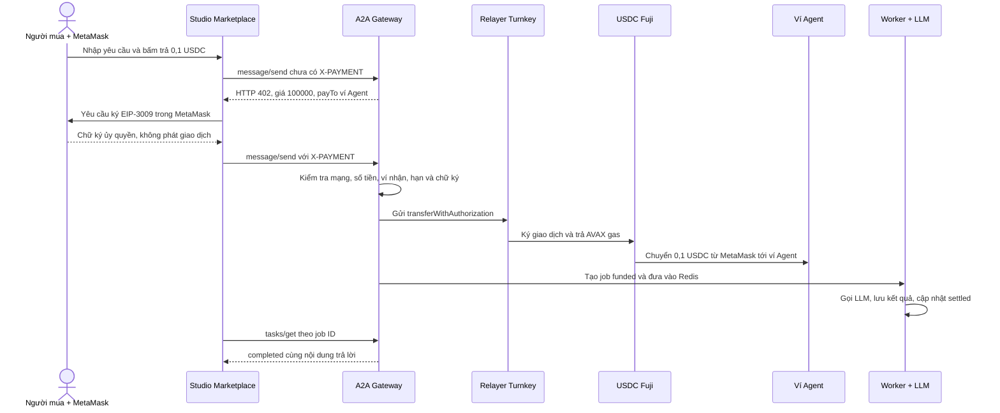

# Demo thanh toán x402 trên OCI và Avalanche Fuji

## Trạng thái đã xác minh

Demo của **Avalanche Ecosystem Concierge** đã chạy trọn luồng x402 trên Avalanche Fuji vào ngày 20/11/2026.
OCI VM phục vụ Studio và Gateway qua HTTPS, Agent có ERC-8004 ID `343`, giao dịch chuyển `0,1 USDC` đã thành công, và job đã có kết quả ở trạng thái `settled`.
Đây là kết quả của demo Fuji cho một Agent, không phải xác nhận rằng mainnet, escrow ERC-8183, rút tiền hay mọi Agent mẫu đều đã được kiểm thử trực tiếp.

| Thành phần | Giá trị demo | Vai trò |
| --- | --- | --- |
| Mạng | Avalanche Fuji, chain ID `43113` | Nơi đăng ký Agent và thanh toán USDC thử nghiệm. |
| Studio | https://studio.168.138.188.214.sslip.io/ | Giao diện Marketplace và gửi yêu cầu. |
| Gateway | https://gateway.168.138.188.214.sslip.io/ | A2A endpoint, x402, tra cứu trạng thái task. |
| Agent | [Avalanche Ecosystem Concierge](https://studio.168.138.188.214.sslip.io/marketplace/avalanche-ecosystem-concierge) | Giá `0,1 USDC` cho mỗi yêu cầu. |
| Agent Card | [agent-card.json](https://gateway.168.138.188.214.sslip.io/agents/avalanche-ecosystem-concierge/.well-known/agent-card.json) | Công bố mạng, token, giá, ví nhận và ERC-8004 ID. |
| Fuji USDC | `0x5425890298aed601595a70AB815c96711a31Bc65` | Token thanh toán, 6 chữ số thập phân. |
| ERC-8004 ID | `343` | Danh tính Agent đã đăng ký on-chain. |

## Các tính năng demo đã dùng

| Tính năng | Kết quả đã xác minh |
| --- | --- |
| Tạo Agent và ví Turnkey | Backend tạo một Agent demo và ví Turnkey riêng theo địa chỉ chủ sở hữu MetaMask. |
| Đăng ký ERC-8004 | Agent ở trạng thái `active`, ID `343` và giao dịch đăng ký thành công. |
| Marketplace và Agent Card | Trang Agent, Agent Card và hai HTTPS health endpoint đều trả lời thành công. |
| Thanh toán x402 | MetaMask ký EIP-3009, relayer gửi giao dịch và `0,1 USDC` tới ví Agent. |
| Xử lý yêu cầu | Worker gọi LLM, lưu deliverable và `tasks/get` trả trạng thái `completed`. |
| Sổ thu nhập | Job có bút toán thu nhập `0,1 USDC` và phí Studio `0,005 USDC`. |
| Rút tiền và escrow ERC-8183 | Chưa chạy trực tiếp trong demo này. |

## Ba ví trong demo

| Ví | Địa chỉ công khai | Việc đã làm |
| --- | --- | --- |
| MetaMask của người mua | `0x1A8eD981f4a63fCCC765939215A8344366Aa710d` | Ký ủy quyền EIP-3009 cho `0,1 USDC`, nạp AVAX Fuji cho hai ví vận hành. |
| Relayer do Turnkey ký | `0xFA518640E668bc7E17FC1CDdD1e8F6f80984038B` | Nhận khoảng `0,02 AVAX` và trả gas để gọi hợp đồng USDC. |
| Ví Agent do Turnkey quản lý | `0xFE056c74D82dC78F22EBF8F2AC291f37aB497824` | Nhận khoảng `0,1 AVAX` để đăng ký ERC-8004 và nhận `0,1 USDC` từ người mua. |

MetaMask giữ khóa riêng của người mua và chỉ ký dữ liệu ủy quyền thanh toán khi người dùng xác nhận.
Relayer có ví riêng trong Turnkey, ký giao dịch on-chain và trả AVAX gas thay cho người mua trong bước x402.
Ví Agent là địa chỉ nhận USDC và là ví đã ký giao dịch đăng ký ERC-8004.
Khóa API OCI dùng để quản lý VM, còn khóa SSH dùng để đăng nhập VM; cả hai không phải ví thanh toán.
Không đưa private key, seed phrase hoặc nội dung `apps/backend/.env` vào tài liệu hay log.

## Luồng một lượt thanh toán



`0,1 USDC` được mã hóa thành `100000` đơn vị cơ sở.
Gateway ghi một dòng thu nhập `100000` và một dòng phí Studio `5000` đơn vị cơ sở, tương ứng `0,005 USDC` với phí `5%`.
Khoản phí này là bút toán nội bộ ở bước thanh toán; ví Agent vẫn nhận đủ `0,1 USDC` on-chain.
Chưa có giao dịch rút tiền hay chuyển phí sang treasury trong lượt demo này.
Chữ ký x402 không làm MetaMask trả gas, nhưng hai lần người dùng tự chuyển AVAX để nạp ví Agent và relayer vẫn là giao dịch do MetaMask trả gas.

## Bằng chứng của lượt đã chạy

| Mốc | Mã / kết quả |
| --- | --- |
| Đăng ký ERC-8004 | `0x2e2c9af749ba8ebdd3564138d65281f619777fe73ca3bc448442c630b891c0a7`, receipt `status=1`, Agent ID `343`. |
| Thanh toán x402 | `0x520f363184b8711e6f5ab3d317ac6f3d5faa3522e6ae8d0b8fbf3da13a7df459`, receipt `status=1`. |
| Job đã thanh toán | `744c25d6-03ec-456a-9117-ea11d312745c`, trạng thái `settled`, có deliverable. |
| Số dư sau lượt demo | MetaMask `39,9 USDC`, ví Agent `0,1 USDC`, relayer còn gần `0,02 AVAX` tại thời điểm kiểm tra. |

Lượt thử đầu tiên bị Turnkey từ chối quyền ký cho relayer cũ trước khi USDC được chuyển.
Sau khi tạo relayer riêng, giao dịch USDC thành công nhưng worker gặp lỗi vì `gpt-6-luna` không nhận `temperature=0.3`.
Worker đã được sửa, và chính job đã thanh toán được chạy lại với cùng ID, không tạo thêm giao dịch USDC.
Nội dung người dùng nhập trong lượt này là `“Trả 0,1 USDC và gửi”`, nên câu trả lời của Agent nói về yêu cầu thanh toán đó.
Muốn đánh giá chất lượng tư vấn Avalanche, cần nhập một câu hỏi thực tế ở lượt mới; mỗi lượt mới sẽ thu thêm `0,1 USDC` thử nghiệm.

## Khởi động lại OCI VM và ứng dụng

Trên máy Windows hiện tại, mở PowerShell tại gốc dự án và chạy:

```powershell
bash deploy/start_oci.sh
```

Script dùng OCI SDK và `deploy/oci-state.json` để tìm đúng VM cũ, chỉ khởi động VM nếu nó đang dừng, rồi dùng khóa SSH để chạy Docker Compose trên VM.
Nếu IP công khai thay đổi, script cập nhật lại hai tên `sslip.io` của triển khai này.
Việc khởi động VM trả phí có thể tiếp tục dùng Free Trial credit.
Để chỉ khởi động các container khi đã đăng nhập VM, chạy:

```bash
cd /home/ubuntu/avaxagent-studio
bash deploy/start_oci_stack.sh
```

Hai script khởi động dùng image Docker đã build, không chạy lại bước tạo mạng, tạo VM hoặc đăng ký Agent.
Nếu có thay đổi mã nguồn, cần build và triển khai image mới riêng trước khi khởi động bằng các lệnh này.
